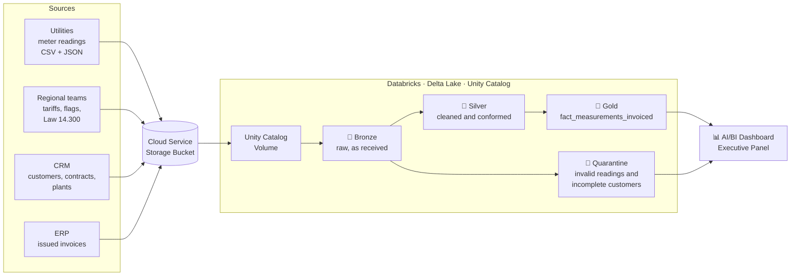

# ⚡ Distributed Generation Billing Assurance

**An end-to-end data engineering project on Databricks that rebuilt 12 months of solar-energy billing from raw meter data and found R$ 1.44 million in billing errors.**


> *Electro Fantasy Co.* is a fictional company, and every dataset in this repository is synthetic. The business rules, tariff flags and regulatory parameters, however, follow how the Brazilian distributed-generation market actually works.

---

## TL;DR

Electro Fantasy Co. sells solar energy credits to 336 business customers in 9 Brazilian states. Billing was calculated by hand in 4 regional spreadsheets, each with its own tariffs, taxes and assumptions. Nobody could say how much the company *should* have invoiced.

This project centralizes every billing assumption, recalculates each customer's invoice from the utility's meter readings, and reconciles the result with what the ERP actually charged.

| What the dashboard shows (10/2025 – 09/2026) | Value |
| --- | --- |
| **Revenue not invoiced** (new model − ERP) | **~ R$ 900K** |
| **Improperly invoiced revenue** (refunds owed to customers) | **~ R$ 500K** |
| Savings delivered to customers | **≈ R$ 4.5 million** (R$ 330K–427K per month) |
| Meter readings quarantined for data quality | **95** (28 consumer units) |

---

## The business problem

In Brazil's **shared distributed generation** model (*geração distribuída compartilhada*), the company operates solar plants connected to the local utility's grid. The energy injected becomes **kWh credits** that offset each customer's electricity bill. Customers then pay the generation company for the compensated kWh, with a contractual discount on the utility's tariff.

Billing sounds simple. It is not, because the reference price changes by **utility, date and plant**:

- 🏢 **9 utilities, 9 tariff schedules.** Each one has its own annual tariff readjustment date.
- 🚦 **Monthly tariff flags.** ANEEL adds a surcharge per kWh every month: green, yellow or red.
- 🧾 **State taxes.** ICMS ranges from 17% to 20.5% depending on the state, plus PIS/COFINS.
- ⚖️ **Law 14.300/2022.** Plants that requested grid access after 7 Jan 2023 (GD II) stop compensating a growing share of the TUSD "Wire B" component: 45% in 2025 and 60% in 2026. Older plants (GD I) are exempt.
- 📄 **Customer contracts.** Discounts from 15% to 25%, start and cancellation dates, monthly kWh quotas.

With four regional teams applying these rules independently, the company kept finding errors in both directions: customers billed after cancellation, discounts that did not match the contract, and revenue that was simply never invoiced.

**Goal:** build a single trusted source for billing and show leadership exactly where money was lost.

---

## Architecture



Every layer has a **historical** pipeline (full 12-month backfill) and an **incremental** pipeline (new monthly files only).

| Layer | What happens there |
| --- | --- |
| 🥉 **Bronze** | One Delta table per source file, stored exactly as received, plus source-file and ingestion-time metadata. Nothing is cleaned, so every number can be traced back to its file. |
| 🥈 **Silver** | Types, units and keys are standardized; duplicates removed; tariff validity periods fixed; superseded file versions dropped. Readings that cannot be billed go to quarantine instead of disappearing. |
| 🚧 **Quarantine** | Measurements with null compensated energy, compensated energy above consumption, or a consumer unit with no contract, plus customers with incomplete records. It works as a to-do list for the billing team. |
| 🥇 **Gold** | Each consumer unit and month is joined to its contract, plant, tariff in force on the reading date, monthly flag and Law 14.300 parameter. The correct invoice is calculated and compared with the ERP. |

---

## The billing model

Every invoice is recalculated from first principles, per consumer unit (UC) and month:

```math
\text{full tariff} = \frac{TE + TUSD + \text{tariff flag}}{1 - ICMS - PIS/COFINS}
```

```math
\text{Wire B cost} =
\begin{cases}
\dfrac{kWh_{compensated} \times TUSD_{Wire\,B} \times \%_{year}}{1 - ICMS - PIS/COFINS} & \text{GD II plants} \\
0 & \text{GD I plants}
\end{cases}
```

```math
\text{invoice} = kWh_{compensated} \times \text{full tariff} \times (1 - \text{discount}) - \text{Wire B cost}
```

Each component is stored as its own column in the Gold table. An auditor can open any invoice and see which tariff, flag, discount and Wire B rule produced it.

---

## Results: what the dashboard revealed

### 1. R$ 931K of revenue was never invoiced

The **Executive Panel** compares, month by month, what the legacy process invoiced (**OLD**) with what the new model says should have been invoiced (**NEW**).

- The legacy process invoiced **≈ R$ 14.7 million** over 12 months. The new model calculates **≈ R$ 15.6 million**.
- **NEW beats OLD in every one of the 12 months.** The gap is structural, not a one-off.
- The net difference, **R$ 931,704.19**, is about **6% of annual revenue** that the company can recover going forward.

### 2. R$ 506K was invoiced improperly

The flip side is a customer-relationship risk: **R$ 505,826.35** was charged for readings that should not have been billed, or for energy above the customer's contracted monthly quota. This is the list the commercial team needs to refund customers **before** they find out on their own.

Together, the two numbers add up to **R$ 1.44 million in billing exposure** found in a single year.

### 3. Billing accuracy collapsed in mid-2026, and the dashboard shows why

The share of UC-months invoiced within R$ 1 of the correct value tells the operational story:

The **"Flag of Additional Charge Monthly"** strip at the top of the panel lines up with this curve. Errors spike exactly when a rule changes: a new flag color or a tariff readjustment. Manual, decentralized processes don't track regulatory change fast enough, and a centralized assumption table fixes that.

### 4. Customers saved ≈ R$ 4.5 million

The **"Money Saved by Customers Monthly"** chart shows the value proposition in reais: **R$ 330K to R$ 427K per month** that customers would otherwise have paid their utility. This is the number sales uses to retain and acquire customers.

### 5. Data quality issues no longer hide

The **Quarantine** page makes data problems visible instead of letting them silently corrupt invoices:

- **95 meter readings quarantined** across **28 consumer units**.
- **6 readings every single month** belong to consumer units with **no contract**. Utilities are assigning credits to UCs that are not the company's customers, which is a recurring allocation error worth raising with them.
- The remaining readings had **null compensated energy** or **compensated energy above consumption**, which is physically impossible and usually a unit error.
- Quarantined readings by region: Southeast **43%**, Northeast **29%**, Center-West **25%**, South **2%**.
- **35 customers** have incomplete records: **77%** are missing a billing email and **23%** a business segment.

<!--
Add dashboard screenshots here, for example:


-->

---

## Repository structure

```
├── dashboard/
│   └── Electrical Company - Executive Panel.lvdash.json   # Databricks AI/BI dashboard
├── datasets/
│   ├── 01_cadastros/          # customers (CRM), contracts per UC, solar plants
│   ├── 02_premissas/          # regional tariffs, monthly tariff flags, Law 14.300 parameters
│   ├── 03_medicoes/           # 49 monthly meter-reading files from utilities (CSV + JSON)
│   └── 04_faturamento/        # ERP invoices: the "before" baseline
└── pipelines/
    ├── 01_ingestion_from_cloudstorage_to_storage_bronze/
    │   ├── historical_data/   # full backfill: bucket → Bronze
    │   └── incremental_data/  # new monthly files only
    ├── 02_extracting_from_bronze_to_treatments_into_silver/
    │   ├── step00_IMPORTS.ipynb
    │   ├── step00_AUXILIARY_FUNCTIONS.ipynb
    │   ├── historical_data/   # one notebook per entity + MEASUREMENTS
    │   └── incremental_data/
    └── 03_loading_from_silver_to_aggregate_into_gold/
        ├── historical_data/   # builds gold.fact_measurements_invoiced
        └── incremental_data/
```

---

## Tech stack

| Purpose | Tool |
| --- | --- |
| Cloud storage | GCP, AWS(s3), etc... |
| Processing | Databricks (serverless), PySpark, Spark SQL |
| Storage format and governance | Delta Lake, Unity Catalog (Volumes, schemas) |
| Architecture | Medallion (Bronze → Silver → Gold) + Quarantine |
| BI | Databricks AI/BI Dashboards |
| Version control | Git / GitHub |

---

## Author

**Arnaldo Bastos** · Data Engineering

If this project was useful or you'd like to talk about data engineering in the energy sector, feel free to connect on LinkedIn.
